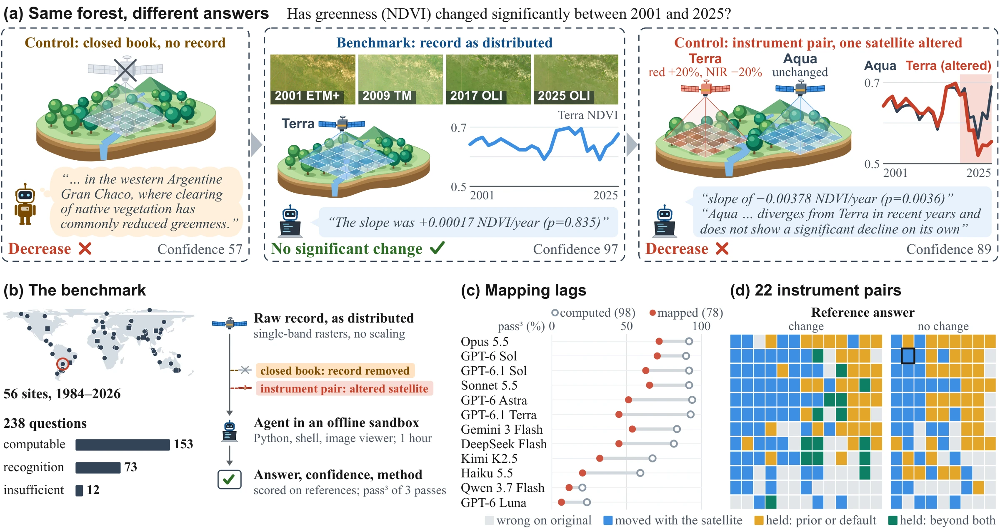

<div align="center">

# 🛰️ EarthRecord

### From Pixels to Land Change with Multimodal Agents over Four Decades of Satellite Imagery

Haoran Zhang<sup>1,2</sup>, Huizhen Sun<sup>1</sup>, Hanbin Wen<sup>3</sup>, Jie Leng<sup>4</sup>, Jiaxin Zhu<sup>4</sup>, Zhaohua Sun<sup>5,*</sup>

<sup>1</sup>AIEyes Technologies (Hong Kong) Co., Limited &nbsp;
<sup>2</sup>The Hong Kong University of Science and Technology (Guangzhou) &nbsp;
<sup>3</sup>Guangdong University of Technology &nbsp;
<sup>4</sup>Anhua Ocean Intelligent Equipment Co., Ltd. &nbsp;
<sup>5</sup>The University of Hong Kong<br>
<sup>*</sup>Corresponding author: joshsun@hku.hk

[](https://ranranrannervous.github.io/EarthRecord/)
[](https://huggingface.co/datasets/haoranranranran/EarthRecord)
[](https://ranranrannervous.github.io/EarthRecord/#leaderboard)
[](pyproject.toml)
[](LICENSE)

</div>

<p align="center">
  
</p>

<p align="center"><sub>
(a) One question answered by GPT-6 Sol without the record, with the record, and with one satellite altered.
(b) Benchmark and protocol. (c, d) Twelve agents: answers needing a map lag those computed from the record, and half
of right answers change when one satellite's data are altered. Landsat data courtesy of the U.S. Geological Survey.
</sub></p>

## 🔔 News

- **[2026-11]** We release the EarthRecord benchmark data, the evaluation code, and the results of all twelve agents.

## 📖 Overview

EarthRecord evaluates whether multimodal agents can turn four decades of raw, multi-sensor satellite records into
reliable land-change analysis. For each question, an agent works in an offline sandbox with Python, a shell and an image
viewer on the record of one site as distributed by its providers: Landsat, MODIS, VIIRS and Sentinel-2 data with
ancillary layers, clipped but with their values unmodified. Data selection, cloud masking, scaling, mapping and
cross-sensor harmonization are left to the agent, and answers are scored against reference answers it never sees.

- 🌍 **56 sites**: 48 core areas and 8 administrative regions, 1984 to 2026.
- ❓ **238 questions** over ten analysis tasks: 153 computable from the record, 73 asking what is on the ground, 12 with
  insufficient evidence.
- 📚 **Closed book**: the same question without the record, to measure what prior knowledge alone can answer.
- 🛰️ **22 instrument pairs**: one satellite's data altered while nothing changes on the ground, with 8 placebo pairs.

This repository holds the evaluation sandbox, the scoring, the results of twelve models and the scripts that reproduce
the paper's tables. The data are on Hugging Face: [haoranranranran/EarthRecord](https://huggingface.co/datasets/haoranranranran/EarthRecord).

## 🏆 Leaderboard

pass³ (%): a question counts when the conclusion is right in all three passes. **Overall**: the 226 computable and
recognition questions with the record, with 95% bootstrap intervals. **Closed book**: the same questions without the
record. **Moved**: right answers on instrument pairs that turn wrong when one satellite's data are altered (lower is
better). Bold marks the best model in each column. The
[project page](https://ranranrannervous.github.io/EarthRecord/#leaderboard) has the full leaderboard with every task.

| Model | Overall | Computable<br><sub>closed book → record</sub> | Recognition<br><sub>closed book → record</sub> | Moved ↓ |
|:---|:---:|:---:|:---:|:---:|
| &nbsp;Opus&nbsp;5.5 | **85.4** <sub>[80.5, 89.8]</sub> | 62.1 → 87.6 | 65.8 → **80.8** | **7/21** |
| &nbsp;GPT-6&nbsp;Sol | 84.1 <sub>[79.2, 88.9]</sub> | 49.0 → 86.9 | 57.5 → 78.1 | 11/19 |
| &nbsp;GPT-6.1&nbsp;Sol | 81.4 <sub>[76.1, 86.3]</sub> | 37.9 → **89.5** | 60.3 → 64.4 | 10/20 |
| &nbsp;Sonnet&nbsp;5.5 | 81.0 <sub>[75.7, 86.3]</sub> | 54.2 → 85.0 | 53.4 → 72.6 | 13/22 |
| &nbsp;GPT-6&nbsp;Astra | 77.0 <sub>[71.2, 82.3]</sub> | 34.0 → 87.6 | 58.9 → 54.8 | 11/21 |
| &nbsp;GPT-6.1&nbsp;Terra | 73.5 <sub>[67.7, 79.2]</sub> | 25.5 → 86.3 | 46.6 → 46.6 | 10/19 |
| &nbsp;Gemini&nbsp;3&nbsp;Flash | 72.6 <sub>[66.8, 77.9]</sub> | 49.7 → 76.5 | 52.1 → 64.4 | 9/17 |
| &nbsp;DeepSeek&nbsp;Flash | 68.1 <sub>[61.9, 74.3]</sub> | 37.9 → 80.4 | 52.1 → 42.5 | 6/17 |
| &nbsp;Kimi&nbsp;K2.5 | 54.0 <sub>[47.8, 60.6]</sub> | 16.3 → 62.7 | 30.1 → 35.6 | 8/15 |
| &nbsp;Haiku&nbsp;5.5 | 41.2 <sub>[35.0, 47.8]</sub> | 25.5 → 49.7 | 43.8 → 23.3 | 8/13 |
| &nbsp;Qwen&nbsp;3.7&nbsp;Flash | 19.5 <sub>[14.6, 24.8]</sub> | 4.6 → 20.9 | 9.6 → 16.4 | 7/8 |
| &nbsp;GPT-6&nbsp;Luna | 18.6 <sub>[13.7, 23.9]</sub> | 12.4 → 17.0 | 27.4 → 21.9 | 7/8 |
| *Majority&nbsp;class* | *23.9* | *24.2* | *23.3* | - |
| *Always&nbsp;no&nbsp;change* | *13.7* | *18.3* | *4.1* | - |

## 🛠️ Installation

```
git clone https://github.com/ranranrannervous/EarthRecord && cd EarthRecord
pip install -e ".[providers]"
docker build -t earthrecord-sandbox:1.0 sandbox/
```

Running models needs Docker (Linux recommended), 4 CPUs and 24 GB of memory per concurrent run, and the API keys of the
providers you use (`OPENAI_API_KEY`, `ANTHROPIC_API_KEY`, `GOOGLE_API_KEY`; for OpenAI-compatible services such as
DeepSeek, Moonshot and DashScope, `<SERVICE>_API_KEY` and `<SERVICE>_BASE_URL`).

## 📦 Data

The dataset is gated: accept its terms on the [dataset page](https://huggingface.co/datasets/haoranranranran/EarthRecord) and
log in with `hf auth login`. Then download and unpack:

```
python scripts/download_data.py                          # all views: about 680 GB, 1.1 TB unpacked with the pair views
python scripts/download_data.py --versions original      # without the instrument-pair views
python scripts/download_data.py --ids a14-5,r-gao-4      # only the views these questions need
```

Every view is checked file by file against its published SHA-256 checksums. See [docs/data.md](docs/data.md) for the
layout and the question and reference formats.

## 🚀 Running

```
python scripts/run.py --models "Opus 5.5" --setting record                       # the main evaluation
python scripts/run.py --models "Opus 5.5" --setting closed_book                  # the closed book
python scripts/run.py --models "Opus 5.5" --setting record --versions altered,placebo   # instrument and placebo pairs
```

Models and their settings are in [configs/models.yaml](configs/models.yaml); add your own by its
[Inspect](https://inspect.aisi.org.uk/) model name. Every question runs for three passes with 3,600 s of working time
and 300 messages per run. The task can also be run directly with Inspect:

```
inspect eval earthrecord/earthrecord --model anthropic/claude-opus-5-5 -T data_dir=data -T setting=record
```

Inspect reports the mean over runs and `at_least_3`, which is pass³. Logs go to `logs/`.

## 📊 Reproducing the paper

```
python scripts/reproduce.py --data-dir data
```

prints Tables 2 to 4, the data of Figures 4 and 6, the instrument-pair shares of Section 4.2, the runs without the image
viewer, and the failure steps and sensor reports of the appendix, from the released results in [results/](results/).
It needs only `questions.jsonl` and `references.jsonl` from the dataset, not the views. See
[docs/results.md](docs/results.md) for the result files and [docs/scoring.md](docs/scoring.md) for the scoring.

## 📁 Repository

```
earthrecord/        task, agent, tools, sandbox, scoring and analysis
sandbox/            Dockerfile of the agent sandbox
configs/            the twelve models of the paper
scripts/            run.py, download_data.py, reproduce.py
results/            per-run results of the twelve models and the appendix codings
docs/               data, scoring and result formats
assets/             README figure and model logos
tests/
```

## 📝 Citation

```bibtex
@misc{zhang2026earthrecord,
  title  = {{EarthRecord}: From Pixels to Land Change with Multimodal Agents over Four Decades of Satellite Imagery},
  author = {Zhang, Haoran and Sun, Huizhen and Wen, Hanbin and Leng, Jie and Zhu, Jiaxin and Sun, Zhaohua},
  year   = {2026}
}
```

## 📄 License

Code: Apache-2.0. The questions, reference answers and checksums are released under CC BY 4.0; the satellite,
reanalysis and map data keep the licences of their providers, listed on the dataset page. Model logos are from
[LobeHub Icons](https://github.com/lobehub/lobe-icons) (MIT) and identify the models only.
